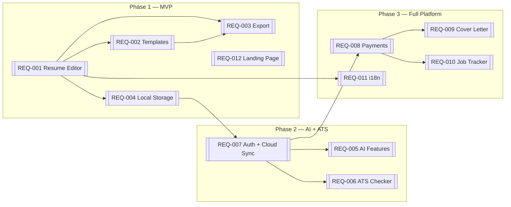

# CVFairy — Knowledge Base Index

**Product:** AI-powered resume builder that beats Enhancv
**Tagline:** "Your resume, your rules. No watermarks. No surprises."

## Why CVFairy Exists

Enhancv and its competitors share common problems:
- No real free tier (watermarks, paywalls, 7-day trials)
- No DOCX export (the #1 user request)
- Expensive subscriptions with no lifetime option
- Opaque ATS scoring that users don't trust
- Limited customization (fixed date formats, locked sections)
- Desktop-only, no offline support

CVFairy fixes all of these while being deployed on Cloudflare's free tier.

## Core Differentiators
1. **Honest free tier** — 3 templates, PDF export, no watermarks, ever
2. **Multi-format export** — PDF, DOCX, HTML, Markdown, TXT, JSON
3. **Transparent ATS** — show exactly what ATS software parses
4. **Local-first** — works offline, data stays on device by default
5. **Lifetime pricing** — $149 once, or $9.99/mo, or free forever

## Requirements Map

## Architecture Decisions
- [[ADR-001-local-first]] — Why local-first and how IndexedDB + cloud sync works
- [[ADR-002-cloudflare-stack]] — Why Cloudflare, what services, free tier limits
- [[ADR-003-pdf-engine]] — Why @react-pdf/renderer for client-side PDF generation
- [[ADR-004-state-management]] — Why Zustand + Immer, store architecture
- [[ADR-005-ai-integration]] — AI model selection, prompt patterns, rate limiting

## Glossary
See [[glossary]] for domain terms (ATS, resume sections, job tailoring, etc.)
